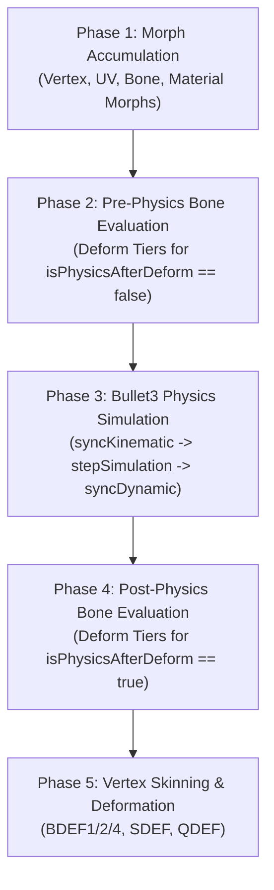

# Master Engineering Specification: Native Linux PMX Editor

> [!IMPORTANT]
> **Purpose of This Document:**
> This is the **single source of truth and low-level engineering specification** for all autonomous coding agents and developers working on the **Native Linux PMX Editor**. Agents starting with zero prior chat context MUST adhere strictly to the binary layouts, C++20 header contracts, coordinate systems, shader uniform blocks, C# plugin interfaces, and IPC schemas defined in this document.

---

## Table of Contents
1. [Executive Summary, Domain Context & Scope](#1-executive-summary-domain-context--scope)
2. [Repository Layout, Build System & Multi-Agent Target Partitioning](#2-repository-layout-build-system--multi-agent-target-partitioning)
3. [PMX 2.0 / 2.1 Binary Format Specification & Canonical C++20 Structs (`PmxCore`)](#3-pmx-20--21-binary-format-specification--canonical-c20-structs-pmxcore)
4. [State Management, `QUndoStack` Architecture & Qt Table Models (`PmxModels`)](#4-state-management-qundostack-architecture--qt-table-models-pmxmodels)
5. [MMD Runtime Evaluation, CCDIK, SDEF Skinning & Bullet3 Physics (`PmxEvaluator`)](#5-mmd-runtime-evaluation-ccdik-sdef-skinning--bullet3-physics-pmxevaluator)
6. [3D Viewport Rendering Pipeline, `QRhi` Shaders & Interactive Tools (`PmxViewport`)](#6-3d-viewport-rendering-pipeline-qrhi-shaders--interactive-tools-pmxviewport)
7. [Built-In Native C++ Power Tools — The "Top 8" Algorithms (`PmxPowerTools`)](#7-built-in-native-c-power-tools--the-top-8-algorithms-pmxpowertools)
8. [External `PEPlugin.dll` & `.css` Compatibility Bridge (`PmxPluginBridge` & `PmxPluginHost`)](#8-external-peplugindll--css-compatibility-bridge-pmxpluginbridge--pmxpluginhost)
9. [Model Context Protocol Server (`PmxMcpServer` / `pmx-mcp`)](#9-model-context-protocol-server-pmxmcpserver--pmx-mcp)
10. [User Stories, Acceptance Criteria & Verification Milestones](#10-user-stories-acceptance-criteria--verification-milestones)

---

## 1. Executive Summary, Domain Context & Scope

### 1.1 Why This Project Exists
**PMXEditor** (by *KyokuhokuP / 極北P*, final Windows release `v0.2.7.3`, July 2022) is the standard model editor, rigging tool, material/morph table editor, and physics debugger for **MikuMikuDance (MMD)** `.pmx` (2.0/2.1) and `.pmd` models. It is closed-source `.NET Framework 4.8 (WinForms)` + `SlimDX (DirectX 9/11)` software.

Linux users currently have no native equivalent:
* **Wine / Bottles Failure Modes:** Running `PmxEditor.exe` under Wine requires `dotnet48`, `d3dx9`, `d3dcompiler_47`, and `ja_JP.UTF-8` font workarounds. Its multi-window WinForms + DirectX swapchain architecture suffers from severe XWayland/Wayland window-focus loss, dropped mouse clicks between `PmxView` and `PmxForm`, black viewports on resize, and Shift-JIS path mojibake.
* **Why Blender (`mmd_tools`) Cannot Replace PMXEditor:**
  1. **Destructive Import/Export Round-Trip:** Blender translates `.pmx` files into internal BMesh/Armature/ShapeKey/ShaderNode structures and re-exports them from scratch, frequently altering vertex index order, breaking custom split normals (ruining anime cel-shading), losing **SDEF (`C`, `R0`, `R1`)** spherical skinning parameters, and mangling 28-channel multiplicative/additive **Material Morphs**.
  2. **Spreadsheet Batch Engineering (`PmxForm`):** Finishing or kitbashing an MMD model requires instant multi-row spreadsheet editing across Materials, Bones, Morphs, Display Frames (`表示枠`), Rigid Bodies (`剛体`), and 6DoF Spring Joints (`Joint`).
  3. **`TransformView` (`T` Window) Runtime Accuracy:** MMD evaluates bones using a specific **Deform Tier (`変形階層`) + After-Physics (`物理後`)** order, a specific **CCDIK** solver, **Append/Grant bone inheritance (`付与`)**, **SDEF skinning**, and **Bullet Physics** constraints. Models that look fine in Blender routinely explode or twist inside-out in MMD unless tested in `TransformView`.
  4. **The `PEPlugin` Automation Ecosystem:** Rigging pleated skirts/hair (`曲面自動設定`) or adding Arm/Wrist twist helper bones with cylindrical weight splitting (`準標準ボーン追加`) takes seconds via PMXEditor plugins vs. hours by hand in Blender.

### 1.2 In-Scope (v1.0) vs. Out-of-Scope (Anti-Goals)
* **In Scope for v1.0:**
  * Lossless binary `.pmx` 2.0 & 2.1 read/write + Kitbash Merge/Append (`追加選択`), legacy `.pmd` import, `.vmd`/`.vpd` motion/pose playback in `TransformView`, and `.obj`/`.fbx`/`.gltf` accessory import via `Assimp`.
  * Single unified Wayland-native Qt 6.8+ QML window (`PmxView` 3D viewport + docked `PmxForm` 8-tab spreadsheet + instant `Edit` $\leftrightarrow$ `TransformView` toggle + optional dual-monitor panel pop-out).
  * `QQuickRHIItem` (`QRhi` Vulkan/OpenGL) renderer with MMD Toon, Sphere Map (`.sph`/`.spa`), Inverted-Hull Edge, Wireframe, Bone/RigidBody/Joint overlays, 3D Gizmos, and BDEF/SDEF Weight Painting.
  * MMD-exact `TransformView` powered by ported `Saba`/`babylon-mmd` CCDIK + Append bone + SDEF math and `Bullet3` (`btDiscreteDynamicsWorld`).
  * **Top 8 Community Plugins Built-In Natively in C++**, plus a Linux Mono **`PmxPluginHost`** (`PEPlugin.dll` + `SlimDX.dll` CPU math shim + `.css` compiler) for external third-party plugins.
  * Built-in **`PmxMcpServer` (`pmx-mcp`)** for live AI Co-Pilot editing and headless CLI automation.
* **Out of Scope for v1.0 (Anti-Goals):**
  * General-purpose 3D sculpting, retopology, or UV island unwrapping (belongs in Blender).
  * Multi-character timeline keyframe animation authoring, camera timelines, or `.fx` MME post-processing video rendering (belongs in MMD).
  * Legacy `<1%` `IPEViewPlugin` plugins that hook raw `SlimDX.Direct3D9.Device` GPU pointers.
  * Legacy `.pmd` binary writer (`.pmd` is imported and upgraded to `.pmx` 2.0/2.1).
  * Live PMX 2.1 SoftBody physics simulation in TransformView (`PmxSoftBody` records are preserved losslessly on read/write, while physics simulation targets RigidBodies + 6DoF Spring Joints).

---

## 2. Repository Layout, Build System & Multi-Agent Target Partitioning

### 2.1 Canonical Directory Structure
```text
/home/oscarc/Documents/MMDs/
├── CMakeLists.txt
├── MASTER_SPECIFICATION.md
├── PRODUCT_REQUIREMENTS_AND_TECHNICAL_BLUEPRINT.md
├── assets/
│   └── toons/                      # Built-in fallback toon01.bmp .. toon10.bmp (256x256 RGB)
├── shaders/                        # Vulkan-compatible GLSL 450 shaders compiled via qt_add_shaders (qsb)
│   ├── mmd_lit.vert
│   ├── mmd_lit.frag
│   ├── mmd_edge.vert
│   ├── mmd_edge.frag
│   ├── overlay_line.vert
│   ├── overlay_line.frag
│   ├── overlay_shape.vert
│   ├── overlay_shape.frag
│   ├── weight_heatmap.vert
│   └── weight_heatmap.frag
├── src/
│   ├── core/                       # Target 1: PmxCore (Static C++20 Lib)
│   │   ├── PmxTypes.h
│   │   ├── PmxDocument.h
│   │   ├── PmxReader.h / .cpp
│   │   ├── PmxWriter.h / .cpp
│   │   ├── PmdImporter.h / .cpp
│   │   ├── AssimpImporter.h / .cpp
│   │   └── PmxMerger.h / .cpp
│   ├── evaluator/                  # Target 2: PmxEvaluator (Static C++20 Lib)
│   │   ├── PmxRuntimeScene.h / .cpp
│   │   ├── MmdCcdIkSolver.h / .cpp
│   │   ├── MmdSdefSkinner.h / .cpp
│   │   ├── MmdPhysicsWorld.h / .cpp
│   │   └── VmdMotionPlayer.h / .cpp
│   ├── models/                     # Target 3: PmxModels (Static C++20 Lib)
│   │   ├── PmxDocumentController.h / .cpp
│   │   ├── PmxUndoCommands.h / .cpp
│   │   ├── PmxSelectionManager.h / .cpp
│   │   ├── PmxInfoModel.h / .cpp
│   │   ├── PmxVertexTableModel.h / .cpp
│   │   ├── PmxMaterialTableModel.h / .cpp
│   │   ├── PmxBoneTableModel.h / .cpp
│   │   ├── PmxMorphTableModel.h / .cpp
│   │   ├── PmxDisplayFrameModel.h / .cpp
│   │   ├── PmxRigidBodyTableModel.h / .cpp
│   │   └── PmxJointTableModel.h / .cpp
│   ├── viewport/                   # Target 4: PmxViewport (Static C++20 Lib)
│   │   ├── PmxViewportItem.h / .cpp
│   │   ├── PmxRhiRenderer.h / .cpp
│   │   ├── PmxCamera.h / .cpp
│   │   ├── PmxGizmo3D.h / .cpp
│   │   ├── PmxPicker.h / .cpp
│   │   └── PmxWeightPainter.h / .cpp
│   ├── powertools/                 # Target 5: PmxPowerTools (Static C++20 Lib)
│   │   ├── CurvedSurfaceRigGenerator.h / .cpp
│   │   ├── SemiStandardBoneGenerator.h / .cpp
│   │   ├── WeightTransferEngine.h / .cpp
│   │   ├── SdefConverter.h / .cpp
│   │   ├── BoneChainPhysicsWizard.h / .cpp
│   │   ├── FaceNormalEditor.h / .cpp
│   │   ├── BatchMorphAndBoneTools.h / .cpp
│   │   └── PmxValidator.h / .cpp
│   ├── plugin_bridge/              # Target 6a: PmxPluginBridge (Static C++20 Lib)
│   │   ├── PmxPluginRpcServer.h / .cpp
│   │   └── PmxPluginManager.h / .cpp
│   ├── plugin_host_cs/             # Target 6b: PmxPluginHost (Mono C# Assemblies)
│   │   ├── SlimDX/                 # Builds SlimDX.dll (Pure CPU Math Shim)
│   │   ├── PEPlugin/               # Builds PEPlugin.dll (100% API-compatible interfaces & classes)
│   │   └── PmxPluginHost/          # Builds PmxPluginHost.exe (Unix socket client + .dll/.css runner)
│   ├── mcp/                        # Target 7: PmxMcpServer & pmx-mcp CLI
│   │   ├── PmxMcpServer.h / .cpp
│   │   └── main_mcp.cpp
│   └── app/                        # Target 8: pmx-editor GUI Executable
│       ├── main.cpp
│       └── qml/
│           ├── Main.qml
│           ├── ViewportPanel.qml
│           ├── InspectorPanel.qml
│           ├── TransformViewDrawer.qml
│           ├── tabs/               # InfoTab, VertexTab, MaterialTab, BoneTab, MorphTab, DisplayTab, RigidBodyTab, JointTab
│           └── dialogs/            # Top 8 Power Tool Dialogs
└── tests/                          # Automated QtTest Suite
    ├── tst_pmx_roundtrip.cpp
    ├── tst_pmx_undo_models.cpp
    ├── tst_pmx_evaluator.cpp
    ├── tst_pmx_powertools.cpp
    └── tst_pmx_mcp.cpp
```

### 2.2 Dependency & Build Contract
* **Compiler:** C++20 (`CMAKE_CXX_STANDARD 20`, `CMAKE_CXX_STANDARD_REQUIRED ON`).
* **Qt 6.8+ Modules:** `Qt6::Core`, `Qt6::Gui`, `Qt6::Quick`, `Qt6::QuickControls2`, `Qt6::Network` (`QLocalServer`/`QLocalSocket`), `Qt6::ShaderTools`, `Qt6::Test`.
* **System Libraries:** `glm` (`libglm-dev`), `Bullet3` (`BulletDynamics`, `BulletCollision`, `LinearMath`), `Assimp` (`libassimp-dev`), optional `mono-devel` (`mcs` / `msbuild` for Target 6b).

---

## 3. PMX 2.0 / 2.1 Binary Format Specification & Canonical C++20 Structs (`PmxCore`)

> [!CAUTION]
> **Critical PMX Binary Rule for Lossless Round-Tripping:**
> 1. **All multi-byte integers and floats are Little-Endian.**
> 2. **Vertex Indices vs. Non-Vertex Indices have DIFFERENT signedness rules:**
>    * **Vertex Index (`globals[2]`):** Size `1` = **`uint8_t`** (`0..255`), Size `2` = **`uint16_t`** (`0..65535`), Size `4` = **`int32_t`** (`0..2147483647`).
>    * **Texture, Material, Bone, Morph, and RigidBody Indices (`globals[3..7]`):** Size `1` = **`int8_t`** (`-128..127`), Size `2` = **`int16_t`** (`-32768..32767`), Size `4` = **`int32_t`**. A value of `-1` (`0xFF` in 1-byte, `0xFFFF` in 2-byte, `0xFFFFFFFF` in 4-byte) MUST be decoded as `-1` (null reference) and re-encoded as `0xFF` / `0xFFFF` / `0xFFFFFFFF` according to the header's index byte size!
> 3. **Text Strings (`PmxText`):** Stored as `int32_t byteLength` followed by `byteLength` bytes encoded in either **UTF-16LE** (`globals[0] == 0`) or **UTF-8** (`globals[0] == 1`).

### 3.1 Exact Binary Stream Layout

#### A. Header & Model Info
| Field | Binary Type | Notes |
| :--- | :--- | :--- |
| `magic` | `char[4]` | Must be `"PMX "` (`0x50, 0x4D, 0x58, 0x20`). |
| `version` | `float` | `2.0f` or `2.1f`. |
| `globalsCount` | `uint8_t` | Always `8` for PMX 2.0/2.1. |
| `globals[0]` | `uint8_t` | Text encoding: `0` = UTF-16LE, `1` = UTF-8. |
| `globals[1]` | `uint8_t` | Additional `vec4` UV count: `0..4`. |
| `globals[2]` | `uint8_t` | Vertex index byte size: `1` (`uint8_t`), `2` (`uint16_t`), or `4` (`int32_t`). |
| `globals[3]` | `uint8_t` | Texture index byte size: `1` (`int8_t`), `2` (`int16_t`), or `4` (`int32_t`). |
| `globals[4]` | `uint8_t` | Material index byte size: `1`, `2`, or `4` (signed). |
| `globals[5]` | `uint8_t` | Bone index byte size: `1`, `2`, or `4` (signed). |
| `globals[6]` | `uint8_t` | Morph index byte size: `1`, `2`, or `4` (signed). |
| `globals[7]` | `uint8_t` | RigidBody index byte size: `1`, `2`, or `4` (signed). |
| `modelNameJp` | `PmxText` | Japanese model name. |
| `modelNameEn` | `PmxText` | English model name. |
| `commentJp` | `PmxText` | Japanese model comment. |
| `commentEn` | `PmxText` | English model comment. |

#### B. Vertex Table (`int32_t vertexCount` followed by `vertexCount` records)
| Field | Binary Type | Condition / Notes |
| :--- | :--- | :--- |
| `position` | `float[3]` | $(x, y, z)$ in MMD left-handed Y-up space. |
| `normal` | `float[3]` | $(nx, ny, nz)$. |
| `uv` | `float[2]` | $(u, v)$. |
| `additionalUVs` | `float[4] * N` | Present if `globals[1] == N` ($N \in [0, 4]$). |
| `weightType` | `uint8_t` | `0`=BDEF1, `1`=BDEF2, `2`=BDEF4, `3`=SDEF, `4`=QDEF (PMX 2.1). |
| **If `BDEF1` (`0`):** | `BoneIdx b0` | `boneWeights[0] = 1.0f`. |
| **If `BDEF2` (`1`):** | `BoneIdx b0, b1`, `float w0` | `boneWeights[1] = 1.0f - w0`. |
| **If `BDEF4` (`2`) or `QDEF` (`4`):** | `BoneIdx b0..b3`, `float w0..w3` | 4 bone indices followed by 4 floats. |
| **If `SDEF` (`3`):** | `BoneIdx b0, b1`, `float w0`, `float C[3]`, `float R0[3]`, `float R1[3]` | 2 bone indices, 1 float weight, and 3 `vec3` SDEF vectors (`C`, `R0`, `R1`). |
| `edgeScale` | `float` | Per-vertex outline multiplier. |

#### C. Face Index Table (`int32_t faceVertexCount` followed by `faceVertexCount` `VertexIdx` values)
* `faceVertexCount` is the total number of vertex indices (always a multiple of 3; `triangleCount = faceVertexCount / 3`).

#### D. Texture Table (`int32_t textureCount` followed by `textureCount` `PmxText` paths)

#### E. Material Table (`int32_t materialCount` followed by `materialCount` records)
* `nameJp` (`PmxText`), `nameEn` (`PmxText`)
* `diffuse` (`float[4]` RGBA), `specular` (`float[3]` RGB), `specularPower` (`float`), `ambient` (`float[3]` RGB)
* `drawFlags` (`uint8_t`: `0x01` NoCull, `0x02` GroundShadow, `0x04` CastShadow, `0x08` ReceiveShadow, `0x10` HasEdge, `0x20` VertexColor [2.1], `0x40` PointDraw [2.1], `0x80` LineDraw [2.1])
* `edgeColor` (`float[4]` RGBA), `edgeSize` (`float`)
* `textureIndex` (`TexIdx`), `sphereTextureIndex` (`TexIdx`), `sphereMode` (`uint8_t`: `0`=None, `1`=Mul `.sph`, `2`=Add `.spa`, `3`=SubTexture)
* `sharedToonFlag` (`uint8_t`):
  * If `0`: `toonIndex` is read as `TexIdx` (`globals[3]` bytes).
  * If `1`: `toonIndex` is read as **`int8_t` (1 byte)** (`0..9` corresponding to `toon01.bmp..toon10.bmp`, or `-1`).
* `memo` (`PmxText`), `faceVertexCount` (`int32_t`, number of face vertex indices consumed by this material).

#### F. Bone Table (`int32_t boneCount` followed by `boneCount` records)
* `nameJp` (`PmxText`), `nameEn` (`PmxText`), `position` (`float[3]`), `parentBoneIndex` (`BoneIdx`), `deformTier` (`int32_t`)
* `boneFlags` (`uint16_t`):
  * **Bit `0x0001` (`TailIsBone`):** If `0`, read `float tailOffset[3]`. If `1`, read `BoneIdx tailBoneIndex`.
  * **Bit `0x0100` (`InheritRotation`) OR `0x0200` (`InheritTranslation`):** Read `BoneIdx inheritParentIndex`, `float inheritWeight`.
  * **Bit `0x0400` (`FixedAxis`):** Read `float fixedAxisVector[3]`.
  * **Bit `0x0800` (`LocalAxis`):** Read `float localAxisX[3]`, `float localAxisZ[3]`.
  * **Bit `0x2000` (`ExternalParent`):** Read `int32_t externalKey`.
  * **Bit `0x0020` (`IK`):** Read `BoneIdx ikTargetBoneIndex`, `int32_t ikLoopCount`, `float ikLimitAngle`, `int32_t ikLinkCount`, followed by `ikLinkCount` `PmxIkLink` records:
    * `BoneIdx linkBoneIndex`, `uint8_t hasAngleLimit`.
    * If `hasAngleLimit != 0`: read `float limitMin[3]`, `float limitMax[3]` (in radians).

#### G. Morph Table (`int32_t morphCount` followed by `morphCount` records)
* `nameJp` (`PmxText`), `nameEn` (`PmxText`), `panelCategory` (`uint8_t`: `0`=Hidden, `1`=Brow, `2`=Eye, `3`=Mouth, `4`=Other), `morphType` (`uint8_t`), `offsetCount` (`int32_t`):
  * **`0` (Group) / `9` (Flip [2.1]):** `MorphIdx morphIndex`, `float weight`.
  * **`1` (Vertex):** `VertexIdx vertexIndex`, `float positionOffset[3]`.
  * **`2` (Bone):** `BoneIdx boneIndex`, `float translation[3]`, `float rotationQuat[4]` $(x, y, z, w)$.
  * **`3..7` (UV / AdditionalUV1..4):** `VertexIdx vertexIndex`, `float uvOffset[4]`.
  * **`8` (Material):** `MatIdx materialIndex` (`-1` = all materials), `uint8_t opType` (`0`=Multiply, `1`=Add), `float diffuse[4]`, `float specular[3]`, `float specularPower`, `float ambient[3]`, `float edgeColor[4]`, `float edgeSize`, `float textureTint[4]`, `float sphereTint[4]`, `float toonTint[4]` (**Total: 28 floats**).
  * **`10` (Impulse [2.1]):** `RigidBodyIdx rigidBodyIndex`, `uint8_t isLocal`, `float velocity[3]`, `float torque[3]`.

#### H. Display Frame Table (`int32_t frameCount`), Rigid Body Table (`int32_t bodyCount`), Joint Table (`int32_t jointCount`) & SoftBody Table (if `version >= 2.1f`)
* **Display Frame (`PmxDisplayFrame`):** `nameJp`, `nameEn`, `uint8_t specialFlag`, `int32_t elementCount` $\times$ (`uint8_t targetType` [`0`=Bone, `1`=Morph], `BoneIdx` or `MorphIdx`).
* **Rigid Body (`PmxRigidBody`):** `nameJp`, `nameEn`, `BoneIdx boneIndex`, `uint8_t groupIndex`, `uint16_t nonCollisionMask`, `uint8_t shape` (`0`=Sphere, `1`=Box, `2`=Capsule), `float size[3]`, `float position[3]`, `float rotation[3]`, `float mass`, `float linearDamping`, `float angularDamping`, `float restitution`, `float friction`, `uint8_t physicsMode` (`0`=FollowBone, `1`=Physics, `2`=PhysicsAndBone).
* **Joint (`PmxJoint`):** `nameJp`, `nameEn`, `uint8_t jointType` (`0`=Spring6DoF), `RigidBodyIdx bodyA`, `RigidBodyIdx bodyB`, `float position[3]`, `float rotation[3]`, `float linearMin[3]`, `float linearMax[3]`, `float angularMin[3]`, `float angularMax[3]`, `float springLinear[3]`, `float springAngular[3]`.
* **SoftBody (`PmxSoftBody` — PMX 2.1 only):** Read and write `int32_t softBodyCount` records losslessly (`nameJp`, `nameEn`, `uint8_t shape`, `MatIdx materialIndex`, `uint8_t group`, `uint16_t mask`, `uint8_t flags`, `int32_t blinkDistance`, `int32_t clusterCount`, `float totalMass`, `float collisionMargin`, `int32_t aeroModel`, `float configVCF..configSHR[12]`, `float clusterParams[6]`, `int32_t iterationParams[4]`, `int32_t materialParams[3]`, anchor rigid bodies array, and vertex pin array).

### 3.2 Canonical C++20 Header Contract (`src/core/PmxTypes.h`)
```cpp
#pragma once
#include <array>
#include <cstdint>
#include <vector>
#include <QString>
#include <glm/glm.hpp>
#include <glm/gtc/quaternion.hpp>

namespace pmx {

struct PmxHeader {
    float version = 2.0f;
    uint8_t textEncoding = 0;       // 0 = UTF-16LE, 1 = UTF-8
    uint8_t additionalVec4Count = 0;// 0..4
    uint8_t vertexIndexSize = 2;    // 1 (uint8), 2 (uint16), 4 (int32)
    uint8_t textureIndexSize = 1;   // 1 (int8), 2 (int16), 4 (int32)
    uint8_t materialIndexSize = 1;
    uint8_t boneIndexSize = 2;
    uint8_t morphIndexSize = 2;
    uint8_t rigidBodyIndexSize = 2;
    bool preserveIndexSizesOnSave = false; // True during round-trip tests
};

struct PmxModelInfo {
    QString modelNameJp;
    QString modelNameEn;
    QString commentJp;
    QString commentEn;
};

enum class WeightType : uint8_t {
    BDEF1 = 0, BDEF2 = 1, BDEF4 = 2, SDEF = 3, QDEF = 4
};

struct PmxVertex {
    glm::vec3 position{0.0f};
    glm::vec3 normal{0.0f, 1.0f, 0.0f};
    glm::vec2 uv{0.0f};
    std::array<glm::vec4, 4> additionalUVs{};
    WeightType weightType = WeightType::BDEF1;
    std::array<int32_t, 4> boneIndices{-1, -1, -1, -1};
    std::array<float, 4> boneWeights{1.0f, 0.0f, 0.0f, 0.0f};
    glm::vec3 sdefC{0.0f};
    glm::vec3 sdefR0{0.0f};
    glm::vec3 sdefR1{0.0f};
    float edgeScale = 1.0f;
};

struct PmxMaterial {
    QString nameJp;
    QString nameEn;
    glm::vec4 diffuse{1.0f};
    glm::vec3 specular{0.0f};
    float specularPower = 5.0f;
    glm::vec3 ambient{0.5f};
    uint8_t drawFlags = 0x1F;
    glm::vec4 edgeColor{0.0f, 0.0f, 0.0f, 1.0f};
    float edgeSize = 1.0f;
    int32_t textureIndex = -1;
    int32_t sphereTextureIndex = -1;
    uint8_t sphereMode = 0; // 0=None, 1=Mul, 2=Add, 3=SubTex
    uint8_t sharedToonFlag = 0;
    int32_t toonIndex = -1;
    QString memo;
    int32_t faceVertexCount = 0;
};

struct PmxIkLink {
    int32_t boneIndex = -1;
    uint8_t hasAngleLimit = 0;
    glm::vec3 limitMin{0.0f};
    glm::vec3 limitMax{0.0f};
};

struct PmxBone {
    QString nameJp;
    QString nameEn;
    glm::vec3 position{0.0f};
    int32_t parentBoneIndex = -1;
    int32_t deformTier = 0;
    uint16_t boneFlags = 0x001E;
    glm::vec3 tailOffset{0.0f};
    int32_t tailBoneIndex = -1;
    int32_t inheritParentIndex = -1;
    float inheritWeight = 1.0f;
    glm::vec3 fixedAxisVector{0.0f};
    glm::vec3 localAxisX{1.0f, 0.0f, 0.0f};
    glm::vec3 localAxisZ{0.0f, 0.0f, 1.0f};
    int32_t externalKey = 0;
    int32_t ikTargetBoneIndex = -1;
    int32_t ikLoopCount = 0;
    float ikLimitAngle = 0.0f;
    std::vector<PmxIkLink> ikLinks;
};

struct VertexMorphOffset { int32_t vertexIndex = -1; glm::vec3 positionOffset{0.0f}; };
struct UvMorphOffset { int32_t vertexIndex = -1; glm::vec4 uvOffset{0.0f}; };
struct BoneMorphOffset { int32_t boneIndex = -1; glm::vec3 translation{0.0f}; glm::quat rotation{1.0f, 0.0f, 0.0f, 0.0f}; };
struct GroupMorphOffset { int32_t morphIndex = -1; float weight = 0.0f; };
struct ImpulseMorphOffset { int32_t rigidBodyIndex = -1; uint8_t isLocal = 0; glm::vec3 velocity{0.0f}; glm::vec3 torque{0.0f}; };
struct MaterialMorphOffset {
    int32_t materialIndex = -1;
    uint8_t opType = 0; // 0 = Multiply, 1 = Add
    glm::vec4 diffuse{1.0f};
    glm::vec3 specular{1.0f};
    float specularPower = 1.0f;
    glm::vec3 ambient{1.0f};
    glm::vec4 edgeColor{1.0f};
    float edgeSize = 1.0f;
    glm::vec4 textureTint{1.0f};
    glm::vec4 sphereTint{1.0f};
    glm::vec4 toonTint{1.0f};
};

struct PmxMorph {
    QString nameJp;
    QString nameEn;
    uint8_t panelCategory = 4;
    uint8_t morphType = 1;
    std::vector<VertexMorphOffset> vertexOffsets;
    std::vector<UvMorphOffset> uvOffsets;
    std::vector<BoneMorphOffset> boneOffsets;
    std::vector<MaterialMorphOffset> materialOffsets;
    std::vector<GroupMorphOffset> groupOffsets;
    std::vector<ImpulseMorphOffset> impulseOffsets;
};

struct PmxDisplayElement {
    uint8_t targetType = 0; // 0 = Bone, 1 = Morph
    int32_t index = -1;
};

struct PmxDisplayFrame {
    QString nameJp;
    QString nameEn;
    uint8_t specialFlag = 0;
    std::vector<PmxDisplayElement> elements;
};

struct PmxRigidBody {
    QString nameJp;
    QString nameEn;
    int32_t boneIndex = -1;
    uint8_t groupIndex = 0;
    uint16_t nonCollisionMask = 0xFFFF;
    uint8_t shape = 0; // 0=Sphere, 1=Box, 2=Capsule
    glm::vec3 size{1.0f};
    glm::vec3 position{0.0f};
    glm::vec3 rotation{0.0f};
    float mass = 1.0f;
    float linearDamping = 0.5f;
    float angularDamping = 0.5f;
    float restitution = 0.0f;
    float friction = 0.5f;
    uint8_t physicsMode = 0; // 0=FollowBone, 1=Physics, 2=PhysicsAndBone
};

struct PmxJoint {
    QString nameJp;
    QString nameEn;
    uint8_t jointType = 0;
    int32_t rigidBodyIndexA = -1;
    int32_t rigidBodyIndexB = -1;
    glm::vec3 position{0.0f};
    glm::vec3 rotation{0.0f};
    glm::vec3 linearLowerLimit{0.0f};
    glm::vec3 linearUpperLimit{0.0f};
    glm::vec3 angularLowerLimit{0.0f};
    glm::vec3 angularUpperLimit{0.0f};
    glm::vec3 springLinearStiffness{0.0f};
    glm::vec3 springAngularStiffness{0.0f};
};

struct PmxSoftBodyAnchor { int32_t rigidBodyIndex = -1; int32_t vertexIndex = -1; uint8_t nearMode = 0; };

struct PmxSoftBody {
    QString nameJp;
    QString nameEn;
    uint8_t shape = 0;
    int32_t materialIndex = -1;
    uint8_t groupIndex = 0;
    uint16_t nonCollisionMask = 0xFFFF;
    uint8_t flags = 0;
    int32_t blinkDistance = 0;
    int32_t clusterCount = 0;
    float totalMass = 1.0f;
    float collisionMargin = 0.05f;
    int32_t aeroModel = 0;
    std::array<float, 12> configFloats{};
    std::array<float, 6> clusterFloats{};
    std::array<int32_t, 4> iterationInts{};
    std::array<int32_t, 3> materialInts{};
    std::vector<PmxSoftBodyAnchor> anchors;
    std::vector<int32_t> pinVertexIndices;
};

struct PmxDocument {
    QString sourceFilePath;
    PmxHeader header;
    PmxModelInfo modelInfo;
    std::vector<PmxVertex> vertices;
    std::vector<int32_t> faceIndices; // Size = 3 * triangleCount
    std::vector<QString> textures;
    std::vector<PmxMaterial> materials;
    std::vector<PmxBone> bones;
    std::vector<PmxMorph> morphs;
    std::vector<PmxDisplayFrame> displayFrames;
    std::vector<PmxRigidBody> rigidBodies;
    std::vector<PmxJoint> joints;
    std::vector<PmxSoftBody> softBodies;
};

} // namespace pmx
```

---

## 4. State Management, `QUndoStack` Architecture & Qt Table Models (`PmxModels`)

### 4.1 Mutation & Undo/Redo Contract
* **`PmxDocumentController` (`QObject`):** Owns the active `pmx::PmxDocument`, `QUndoStack`, `PmxSelectionManager`, and the 8 table models.
* **Command Pattern (`PmxUndoCommands.h`):**
  1. `PmxPropertyEditCommand<T>`: Edits one or more row fields in any table (`Material`, `Bone`, `Morph`, `RigidBody`, `Joint`, `Vertex`). Implements `id()` and `mergeWith()` so dragging a slider or spinbox coalesces continuous edits into a single undo step.
  2. `PmxVertexTransformCommand`: Stores sparse `(vertexIndex, oldPos, newPos, oldNormal, newNormal)` deltas for 3D gizmo transforms and face-normal edits.
  3. `PmxWeightPaintStrokeCommand`: Stores sparse `(vertexIndex, oldWeightData, newWeightData)` deltas for weight painting and SDEF conversion.
  4. `PmxDocumentSnapshotCommand`: Used by complex structural operations (Kitbash Merge, Curved Surface Auto-Rigging, Semi-Standard Bone insertion, external `PEPlugin` updates, and MCP batch mutations) to swap `PmxDocument` states in $O(1)$ pointer time and emit `modelReset()` on affected table models.

### 4.2 Virtualized `QAbstractTableModel` Schemas
All 8 inspector tabs bind to `QAbstractTableModel` subclasses supporting:
* **`displayLanguage` property (`JP` vs `EN`):** Dynamically switches display names and column headers between Japanese (`ボーン名`, `変形階層`, `剛体`) and English (`Bone Name`, `Deform Tier`, `Rigid Body`).
* **Batch Math Operations (`applyBatchOperation(rowIndices, column, opType, operand)`):** Supports `+` (Add), `*` (Multiply), and `=` (Assign) across any multi-selected rows (e.g., scaling `edgeSize` by `0.5` across 30 materials at once).

---

## 5. MMD Runtime Evaluation, CCDIK, SDEF Skinning & Bullet3 Physics (`PmxEvaluator`)

### 5.1 Coordinate System Handedness & Limit Conversions
* **MMD / PMX Space:** **Left-Handed, Y-Up** ($+X$ Right (model's left), $+Y$ Up, $+Z$ Forward/Away from camera).
* **OpenGL / Vulkan (`QRhi`) & Bullet3 Space:** **Right-Handed, Y-Up** ($+X$ Right, $+Y$ Up, $-Z$ Forward).
* **Mandatory Conversion Rules at the Evaluation / Import Boundary:**
  * **Position / Translation:** $\mathbf{p}_{RH} = (p_x, p_y, -p_z)$.
  * **Euler Rotation ($YXZ$ intrinsic / $ZXY$ extrinsic MMD order):** $\mathbf{r}_{RH} = (-r_x, -r_y, r_z)$.
  * **Quaternion:**
    * Component mapping: $(x', y', z', w') = (-x, -y, z, w)$.
    * GLM constructor order: `glm::quat(w, -x, -y, z)`.
    * Matrix equivalence: $\mathbf{M}_{RH} = \mathbf{S}_z \mathbf{M}_{LH} \mathbf{S}_z$ where $\mathbf{S}_z = \text{diag}(1, 1, -1)$.
  * **Angular Limits (IK Chain Links & 6DoF Spring Joints):**
    * MMD stores limits in Left-Handed radians $(\min_{LH}, \max_{LH})$.
    * In Right-Handed space, **all three axes are negated and min/max swapped**:
      $$\min X_{RH} = -\max X_{LH}, \quad \max X_{RH} = -\min X_{LH}$$
      $$\min Y_{RH} = -\max Y_{LH}, \quad \max Y_{RH} = -\min Y_{LH}$$
      $$\min Z_{RH} = -\max Z_{LH}, \quad \max Z_{RH} = -\min Z_{LH}$$

### 5.2 Exact MMD Frame Evaluation Lifecycle (`PmxRuntimeScene::evaluate`)
MMD does **not** evaluate bones in simple array order. Each 60 Hz frame MUST execute across 5 sequential phases:



#### Phase 1: Morph Accumulation
* Reset all morph accumulators to zero / default state.
* Recursively unpack Group Morphs (`morphType == 0`) with cycle protection to determine effective weights for leaf morphs.
* Accumulate Vertex Morphs ($\mathbf{p} += \mathbf{p}_{\text{offset}} \cdot w$), UV Morphs, Bone Morphs ($\mathbf{t}_{\text{morph}} += \mathbf{t}_{\text{offset}} \cdot w, \mathbf{q}_{\text{morph}} = \text{slerp}(I, \mathbf{q}_{\text{offset}}, w) \cdot \mathbf{q}_{\text{morph}}$), and 28-channel Material Morphs (Multiply pass followed by Add pass).

#### Phase 2 & Phase 4: Bone Hierarchy & Deform Tier Pass (`UpdateNodeAnimation`)
MMD separates bones into Pre-Physics (`isPhysicsAfterDeform == false`) and Post-Physics (`isPhysicsAfterDeform == true`). Within each group, bones are evaluated according to **Deform Tier (`deformDepth` / 変形階層)** across 4 passes:

1. **Pass 1 (Local Transforms):**
   For all bones in the active group:
   $$\mathbf{t}_{\text{base}} = \mathbf{t}_{\text{rest}} + \mathbf{t}_{\text{vmd}} + \mathbf{t}_{\text{morph}}, \quad \mathbf{q}_{\text{base}} = \mathbf{q}_{\text{vmd}} \cdot \mathbf{q}_{\text{morph}}$$
   $$\mathbf{M}_{\text{local}} = \text{translate}(\mathbf{t}_{\text{base}}) \cdot \text{mat4}(\mathbf{q}_{\text{base}})$$
2. **Pass 2 (Hierarchy Propagation):**
   For all root bones (`parentIndex < 0`): recursively propagate world transforms down the parent-child tree:
   $$\mathbf{M}_{\text{world, child}} = \mathbf{M}_{\text{world, parent}} \cdot \text{translate}(\mathbf{p}_{\text{rest, child}} - \mathbf{p}_{\text{rest, parent}}) \cdot \mathbf{M}_{\text{local, child}}$$
3. **Pass 3 (Interleaved Deform Tier Pass — The Critical Invariant):**
   Iterate through bones sorted by `deformDepth` (and array index for ties):
   * **IK Solvers:** If the bone is an IK root (e.g. `足ＩＫ.L` at `deformDepth = 1`, flag `0x0020`), execute `MmdCcdIkSolver::solveChain`.
     * Solves each link in the chain (e.g., knee `ひざ.L`, thigh `足.L`), computing `ikRotation`.
     * Immediately update local matrices and propagate world matrices down each link's child subtree.
   * **Append Bones (Grant Transforms / 付与親):** If the bone has `InheritRotation` (`0x0100`) or `InheritTranslation` (`0x0200`):
     * Fetch the source bone `inheritParentIndex`.
     * **MANDATORY IK PROPAGATION INVARIANT:** If the source bone is an IK link or has IK rotation, the inherited rotation MUST include `ikRotation`:
       $$R_{\text{src}} = \mathbf{q}_{\text{src,ik}} \cdot (\mathbf{q}_{\text{src,vmd}} \cdot \mathbf{q}_{\text{src,morph}})$$
       $$T_{\text{src}} = \mathbf{t}_{\text{src,vmd}} + \mathbf{t}_{\text{src,morph}}$$
     * Blend by `inheritWeight` $w$:
       $$\mathbf{q}_{\text{append}} = \begin{cases} \text{slerp}(I, R_{\text{src}}, w) & \text{if } w \ge 0 \\ \text{slerp}(I, \text{conjugate}(R_{\text{src}}), -w) & \text{if } w < 0 \end{cases}$$
       $$\mathbf{t}_{\text{append}} = T_{\text{src}} \cdot w$$
     * Apply to the append bone's local transform:
       $$\mathbf{M}_{\text{local}} = \text{translate}(\mathbf{t}_{\text{base}} + \mathbf{t}_{\text{append}}) \cdot \text{mat4}(\mathbf{q}_{\text{ik}} \cdot \mathbf{q}_{\text{base}} \cdot \mathbf{q}_{\text{append}})$$
     * Immediately update the append bone's world matrix and propagate down its child subtree.
4. **Pass 4 (Final Hierarchy Synchronization):**
   Re-synchronize all root bone hierarchies to ensure complete downstream consistency.

#### Phase 3: Bullet3 Physics Simulation (`MmdPhysicsWorld::stepSimulation`)
* For all Rigid Bodies with `physicsMode == FollowBone (0)`: sync kinematic world transforms from linked bone matrices.
* If `deltaTime > 0.0f`: step `btDiscreteDynamicsWorld::stepSimulation(deltaTime)` and sync Dynamic (`1`) and PhysicsAndBone (`2`) bodies back to their linked bones.
* If `deltaTime == 0.0f` (timeline scrub / static pose): execute `resetToBoneTransforms(scene)` to align dynamic bodies to current bone coordinates, preventing stale rest-pose snapping.

#### Phase 5: Vertex Skinning & Deformation
* Compute final skinning matrix for each bone: $\mathbf{M}_b = \mathbf{W}_b \cdot \mathbf{B}_b^{-1}$ (where $\mathbf{B}_b^{-1} = \text{translate}(-\mathbf{p}_{\text{rest, b}})$).
* **For `BDEF1` / `BDEF2` / `BDEF4`:** Standard linear blend skinning $\mathbf{p}' = \sum w_i \mathbf{M}_{b_i} (\mathbf{p} + \mathbf{p}_{\text{morph}})$.
* **For `SDEF` (Spherical Skinning — Saba / babylon-mmd specification):**
  Given bones $b_0, b_1$, weights $w_0, w_1 = 1 - w_0$, and SDEF parameters $\mathbf{C}, \mathbf{R}_0, \mathbf{R}_1$:
  $$\mathbf{q} = \text{slerp}(\mathbf{q}_{b_0}, \mathbf{q}_{b_1}, w_1), \quad \mathbf{R}_{\text{mat}} = \text{mat3}(\mathbf{q})$$
  $$\mathbf{r}_0 = \mathbf{M}_{b_0} \mathbf{R}_0 - \mathbf{R}_{\text{mat}} \mathbf{R}_0, \quad \mathbf{r}_1 = \mathbf{M}_{b_1} \mathbf{R}_1 - \mathbf{R}_{\text{mat}} \mathbf{R}_1$$
  $$\mathbf{p}_{\text{skinned}} = \mathbf{R}_{\text{mat}}(\mathbf{p} + \mathbf{p}_{\text{morph}} - \mathbf{C}) + w_0 \mathbf{r}_0 + w_1 \mathbf{r}_1 + w_0 (\mathbf{M}_{b_0}\mathbf{C}) + w_1 (\mathbf{M}_{b_1}\mathbf{C})$$
  $$\mathbf{n}_{\text{skinned}} = \text{normalize}(\mathbf{R}_{\text{mat}} \mathbf{n})$$

### 5.3 Semi-Standard D-Bone (`足D`, `ひざD`, `足首D`) Rigging Architecture
In standard production MMD models (including Barbara, Genshin, and Tda models):
1. **Mesh Skinning Targets D-Bones Exclusively:**
   Vertices in the legs are **not** weighted to the IK chain bones (`足.L`, `ひざ.L`, `足首.L`). Instead, 100% of the leg vertices are bound to `足D.L`, `ひざD.L`, and `足首D.L`.
2. **D-Bones Are Append Bones, Not Children:**
   The parent of `足D.L` is `腰キャンセル.L`. `足D.L` has flag `InheritRotation` (`0x0100`, weight `1.0`) pointing to `足.L`.
3. **Execution Order Requirement:**
   `足D.L` has `deformDepth = 1`, placed in bone order **after** `足ＩＫ.L`. When `足ＩＫ.L` solves, `足.L` and `ひざ.L` receive `ikRotation`. Subsequently, `足D.L` and `ひざD.L` execute in Pass 3 and copy `ikRotation` into their transforms. If an engine evaluates append bones before IK or ignores `ikRotation`, the mesh legs remain frozen in the FK pose while only the invisible IK bones move.

### 5.4 CCD-IK Hinge Plane Solver (`SolvePlane`)
For single-axis hinge links (such as knee `ひざ.L` / `ひざ.R` where only X rotation is non-zero):
1. Transform effector position $\mathbf{p}_e$ and IK target position $\mathbf{p}_t$ into link local coordinates:
   $$\mathbf{v}_e = \text{normalize}(\mathbf{M}_{\text{link}}^{-1} \mathbf{p}_e), \quad \mathbf{v}_t = \text{normalize}(\mathbf{M}_{\text{link}}^{-1} \mathbf{p}_t)$$
2. Compute unsigned rotation angle $\theta = \arccos(\text{clamp}(\mathbf{v}_e \cdot \mathbf{v}_t, -1, 1))$ clamped by `chain.limitAngle`.
3. Test $+ \theta$ and $-\theta$ around the hinge axis $\hat{\mathbf{a}} = (1, 0, 0)$: choose the signed step $\Delta \theta = \pm \theta$ that maximizes $(\text{rot}(\Delta \theta, \hat{\mathbf{a}}) \mathbf{v}_e) \cdot \mathbf{v}_t$.
4. **Iteration-0 Sign Flip:** If $\theta_{\text{new}} = \theta_{\text{plane}} + \Delta \theta$ violates the limits $[\min X_{RH}, \max X_{RH}]$, but $-\theta_{\text{new}}$ lies within the limits, invert the sign: $\theta_{\text{new}} = -\theta_{\text{new}}$.
5. Clamp $\theta_{\text{new}} = \text{clamp}(\theta_{\text{new}}, \min X_{RH}, \max X_{RH})$ and update:
   $$\mathbf{q}_{\text{ik}} = \text{angleAxis}(\theta_{\text{new}}, \hat{\mathbf{a}}) \cdot \text{inverse}(\mathbf{q}_{\text{vmd}})$$


---

## 6. 3D Viewport Rendering Pipeline, `QRhi` Shaders & Interactive Tools (`PmxViewport`)

### 6.1 `QQuickRHIItem` Architecture
`PmxViewportItem` subclasses `QQuickRHIItem` and creates `PmxRhiRenderer` (`QQuickRHIItemRenderer`). All shaders are written in Vulkan-compatible **GLSL 450** and compiled at build time into `.qsb` assets via `qt_add_shaders()`.

### 6.2 Shader Uniform Block Layout (`std140`, Binding 0)
```glsl
layout(std140, binding = 0) uniform FrameAndMaterialUbo {
    mat4 u_mvp;
    mat4 u_modelView;
    mat4 u_normalMatrix;
    vec4 u_lightDir;          // Normalized directional light in view space
    vec4 u_lightColor;        // Default (0.6, 0.6, 0.6, 1.0)
    vec4 u_cameraPos;

    // Material base properties (after Material Morph Mul & Add evaluation)
    vec4 u_diffuse;           // RGBA
    vec4 u_specular;          // RGB + A=specularPower
    vec4 u_ambient;           // RGB
    vec4 u_edgeColor;         // RGBA
    vec4 u_edgeParams;        // x=edgeSize, y=screenHeight, z=sphereMode (0..3), w=hasToon (0/1)
    vec4 u_texTintMul;
    vec4 u_texTintAdd;
    vec4 u_sphereTintMul;
    vec4 u_sphereTintAdd;
    vec4 u_toonTintMul;
    vec4 u_toonTintAdd;
};
```
* **Texture Samplers:**
  * `binding = 1`: `u_baseTex` (2D diffuse texture; defaults to `1x1` white pixel if `textureIndex == -1`).
  * `binding = 2`: `u_toonTex` (2D toon ramp texture; samples `v = 1.0 - clamp(dot(N, L) * 0.5 + 0.5, 0.0, 1.0)`).
  * `binding = 3`: `u_sphereTex` (2D sphere map; UV computed from view-space normal $\mathbf{n}_v$: $u = 0.5 + 0.5 n_{vx},\; v = 0.5 - 0.5 n_{vy}$).

### 6.3 Interactive 3D Viewport Features
1. **Camera Controls (`PmxCamera`):** Orbit (Middle-drag or Alt+Left-drag), Pan (Shift+Middle-drag), Zoom (Scroll wheel), Frame Selected (`F`), Front/Side/Top/Perspective numpad shortcuts.
2. **Picking (`PmxPicker`):** CPU BVH raycasting for single-click Vertex/Bone/RigidBody/Joint selection + 2D screen-space frustum projection for Box (`B`) and Lasso selection, with optional back-face occlusion culling toggle (`表頂点のみ選択`).
3. **3D Transform Gizmo (`PmxGizmo3D`):** Translate, Rotate, and Scale manipulators operating in World or Local Bone space, supporting soft falloff (proportional editing) and X-axis mirror symmetry (`対称編集`).
4. **Interactive Weight Painter (`PmxWeightPainter`):** Brush circle overlay with adjustable radius, strength, and falloff; modes: `Add`, `Subtract`, `Replace`, `Smooth (Laplacian neighbor average)`, and `Normalize`. Automatically preserves `BDEF1`/`BDEF2`/`BDEF4`/`SDEF` weight invariants ($\sum w_i = 1.0$).

---

## 7. Built-In Native C++ Power Tools — The "Top 8" Algorithms (`PmxPowerTools`)

All 8 power tools live in `src/powertools/`, operate purely on `pmx::PmxDocument`, and return a `PmxDocumentSnapshotCommand` for instant `Ctrl+Z` undo:

### 7.1 Tool 1: Curved Surface Auto-Rigging (`CurvedSurfaceRigGenerator` — `曲面自動設定`)
* **Input:** Selected vertex indices (representing a skirt, dress, cape, or wide hair sheet), root parent bone (e.g., `下半身`), grid dimensions $(N_{\text{radial}}, N_{\text{vertical}})$, `isClosedCylinder` (`true` for skirts, `false` for capes/hair), and physics preset (`ShortSkirt`, `LongSkirt`, `Cape`, `HairSheet`).
* **Algorithm:**
  1. Compute principal axis / cylindrical coordinates $(\theta, y, r)$ around the centroid of the top boundary loop of the selected vertices.
  2. Sample an $(N_{\text{radial}} \times N_{\text{vertical}})$ grid of surface points by bilinear/ray projection onto the selected mesh triangles.
  3. Create $N_{\text{radial}}$ bone chains of length $N_{\text{vertical}}$ (`スカート_v_h`), setting `TailIsBone` links down each vertical chain.
  4. Assign smooth bilinear/bicubic `BDEF4` (or `SDEF` along vertical segments) weights to every selected vertex based on its $(\theta, y)$ cell coordinates.
  5. Create Capsule `PmxRigidBody` elements for each bone: row `0` (hip attachment) set to `FollowBone (0)`, rows `1..N` set to `Physics (1)` (or `PhysicsAndBone (2)`) with capsule radius proportional to horizontal arc spacing.
  6. Create vertical 6DoF Spring Joints (`スカートJ_v_h`) linking $(v, h) \to (v+1, h)$ AND horizontal cross-joints (`横スカートJ_v_h`) linking $(v, h) \to (v, (h+1) \bmod N_{\text{radial}})$ with preset angular limits so legs cannot penetrate the skirt.

### 7.2 Tool 2: Semi-Standard Bone Generator (`SemiStandardBoneGenerator` — `準標準ボーン追加`)
Supports independent checkboxes for each standard MMD helper bone:
1. **`全ての親` (`Mother Bone`):** Inserted at $(0,0,0)$ at `deformTier = 0`; reparents root bones (`センター`, `グルーブ`, `足ＩＫ`, `つま先ＩＫ`) under `全ての親` and adds to the `Root` Display Frame.
2. **`グルーブ` (`Groove`):** Inserted at `センター` position as child of `センター`, reparenting `上半身` and `下半身` under `グルーブ`.
3. **`腰` (`Waist`) & `腰キャンセルL/R` (`Waist Cancel`):** Inserted between `グルーブ`/`センター` and `下半身`, with `腰キャンセルL/R` using `InheritRotation` (`weight = -1.0f`) referencing `腰` and reparenting `左足`/`右足`.
4. **`上半身2` (`Upper Body 2`):** Splits `上半身` $\to$ `首` midpoint and smoothly splits torso vertex weights along the $Y$ plane.
5. **`腕捩` (`Arm Twist L/R` + `腕捩1/2/3`) & `手捩` (`Wrist Twist L/R` + `手捩1/2/3`):**
   * Computes arm axis vector $\hat{\mathbf{a}} = \text{normalize}(\mathbf{p}_{\text{elbow}} - \mathbf{p}_{\text{shoulder}})$ (and forearm axis $\text{normalize}(\mathbf{p}_{\text{wrist}} - \mathbf{p}_{\text{elbow}})$).
   * Inserts main twist bone (`FixedAxis = 0x0400`, `fixedAxisVector = \hat{\mathbf{a}}`) at $55\%$ down the limb, plus 3 `InheritRotation` helper bones (`腕捩1`, `腕捩2`, `腕捩3` with `inheritWeight` = $0.25, 0.50, 0.75$) at $25\%, 50\%, 75\%$ along the limb.
   * **Cylindrical Weight Splitting:** Projects all vertices weighted to `左腕` (or `左ひじ`) onto $\hat{\mathbf{a}}$ to compute normalized longitudinal parameter $t \in [0, 1]$, and redistributes the limb's weight smoothly across `[BaseBone, Twist1, Twist2, Twist3, MainTwist]` so twisting the wrist produces zero candy-wrapper collapse.
6. **`親指０` (`Thumb0 L/R`), `足先EX` (`Toe EX L/R`), and `足D`/`ひざD`/`足首D` (`IK-Link D-Bones`):** Inserted with exact Soboro-standard `InheritRotation` flags and Display Frame entries.

### 7.3 Tool 3: Weight Transfer (`WeightTransferEngine` — `ウェイト転送`)
* Builds an AABB / BVH tree over all triangles belonging to `sourceMaterialIndices`.
* For each vertex in `targetMaterialIndices`, finds the closest point $\mathbf{q}$ on the source triangle mesh with barycentric coordinates $(\lambda_0, \lambda_1, \lambda_2)$.
* Interpolates the 3 source triangle vertices' bone weights (and, if any source vertex uses `SDEF` and all 3 share the same 2 bone indices, barycentrically interpolates `sdefC`, `sdefR0`, and `sdefR1`!), normalizes the top 4 weights, and assigns `BDEF1`/`BDEF2`/`BDEF4`/`SDEF`.

### 7.4 Tool 4: SDEF Auto-Converter (`SdefConverter` — `ボーンウェイトSDEF化`)
* For selected vertices (or vertices weighted to a target child/parent bone pair $(b_0, b_1)$):
  * Filters or reduces weights to the top 2 bones $(b_0, b_1)$ with $w_0 + w_1 = 1.0$.
  * Computes `sdefC` by projecting the vertex position $\mathbf{p}$ onto the line segment connecting $\mathbf{p}_{b_0}$ and $\mathbf{p}_{b_1}$.
  * Computes `sdefR0` and `sdefR1` along the bone segment offsets and sets `weightType = WeightType::SDEF`.

### 7.5 Tool 5: Bone-Chain Hair/Tail Physics Wizard (`BoneChainPhysicsWizard`)
* Given selected bone chains, walks each root-to-tip chain, creates a `FollowBone` root capsule and `Physics` child capsules tapering from `radiusRoot` to `radiusTip`, assigns a shared non-self-colliding `groupIndex` if requested, and links consecutive bodies with `Spring6DoF` joints with linearly interpolated damping and spring stiffness.

### 7.6 Tool 6: Anime Face Normal Editor (`FaceNormalEditor` — `法線編集`)
* Fits or accepts a proxy sphere/ellipsoid center $\mathbf{c}$ and radii $(r_x, r_y, r_z)$ over the selected face vertices/materials, and blends each vertex normal $\mathbf{n}_i$ toward the outward ellipsoid gradient $\text{normalize}\left(\frac{p_x - c_x}{r_x^2}, \frac{p_y - c_y}{r_y^2}, \frac{p_z - c_z}{r_z^2}\right)$ by factor $\alpha \in [0, 1]$.

### 7.7 Tool 7: Multi-Stage Bone Splitter (`多段ボーン化`) & Batch Material Morph Creator (`材質モーフ一括作成`)
* **Multi-Stage Bone Splitter:** Inserts a parent or child bone at the same position as the selected bone(s) and updates hierarchy/Display Frames.
* **Batch Material Morph Creator:** Creates one-click `Hide/Show Outfit` morphs (`opType = 0` Multiply with `diffuse.a = 0`, `specular = 0`, `edgeColor.a = 0`, `edgeSize = 0`, `textureTint.a = 0`, `sphereTint.a = 0`, `toonTint.a = 0` across all selected materials) or `Blush / Shadow / Emission Tint` morphs.

### 7.8 Tool 8: PMX Model Diagnostics & Crash Validator (`PmxValidator` — `PMXデータの状態検証`)
Scans `PmxDocument` and returns a structured list of `ValidationIssue` records (`Severity::Info`, `Warning`, `CrashError`) with a 1-click `autoFixAll()` routine:
1. **Zero-Length Normals (`||n|| < 1e-6`):** *Auto-fix:* Recompute from adjacent face normals or set to $(0, 1, 0)$.
2. **Invalid / Out-of-Range Bone Indices on Vertices or Unweighted Vertices ($\sum w_i == 0$):** *Auto-fix:* Bind to `センター` (`0`) with `BDEF1` weight `1.0`.
3. **Degenerate / Duplicate Faces (`v0 == v1 || v1 == v2 || v2 == v0`):** *Auto-fix:* Remove degenerate triangles and adjust material `faceVertexCount`.
4. **Cyclic Bone Parent Hierarchy or Out-of-Order `deformTier` where child evaluates before parent:** *Auto-fix:* Break cycle or bump child `deformTier`.
5. **Broken `RigidBody.boneIndex == -1`:** *Auto-fix:* Bind to bone `0` (`全ての親` / `センター`) in `FollowBone` mode.
6. **Broken `Joint.rigidBodyIndexA == -1` or `rigidBodyIndexB == -1` (Instant MMD Crash!):** *Auto-fix:* Delete broken joint or bind to valid body.
7. **Bones or Morphs Missing from `DisplayFrames` (`表示枠`):** *Auto-fix:* Append unregistered bones/morphs to `その他` / `Other` frame.
8. **Linux Texture Path Case-Sensitivity / Backslash Mismatch:** *Auto-fix:* Normalize `\` to `/` and match actual case on disk.

---

## 8. External `PEPlugin.dll` & `.css` Compatibility Bridge (`PmxPluginBridge` & `PmxPluginHost`)

### 8.1 Clean-Room `PEPlugin.dll` & `SlimDX.dll` Assembly Contract
To run unmodified Windows PMXEditor plugins (`.dll` and `.css`) natively on Linux under Mono (`mono PmxPluginHost.exe`), `src/plugin_host_cs/` compiles two assemblies with exact assembly names and namespaces:
1. **`SlimDX.dll` (`AssemblyName = "SlimDX"`, `Version = 4.0.13.43`, `PublicKeyToken = null`):**
   * Implements `namespace SlimDX`: structs `Vector2`, `Vector3`, `Vector4`, `Quaternion`, `Matrix`, `Color3`, `Color4` with all standard static/instance operators and methods (`Dot`, `Cross`, `Length`, `LengthSquared`, `Normalize`, `Lerp`, `Transform`, `TransformCoordinate`, `TransformNormal`, `RotationAxis`, `RotationYawPitchRoll`, `RotationQuaternion`, `Invert`, `Transpose`, `Slerp`).
2. **`PEPlugin.dll` (`AssemblyName = "PEPlugin"`, `PublicKeyToken = null`):**
   * Implements namespaces:
     * `PEPlugin`: `IPEPlugin`, `IPEPluginOption`, `IPERunArgs`, `IPEPluginHost`, `IPEConnector`, `IPEBuilder`, `PEPluginClass`, `PEPluginOption`, `PEStaticBuilder`.
     * `PEPlugin.SDX`: `V2`, `V3`, `V4`, `Q`, `Color3`, `Color4` (with implicit conversion operators to/from `SlimDX.Vector2/3/4/Quaternion/Color3/Color4`).
     * `PEPlugin.Pmx`: `IPXPmxConnector`, `IPXPmxBuilder`, `IPXPmx`, `IPXHeader`, `IPXModelInfo`, `IPXVertex`, `IPXMaterial`, `IPXBone`, `IPXIK`, `IPXIKLink`, `IPXMorph`, `IPXVertexMorphOffset`, `IPXUVMorphOffset`, `IPXBoneMorphOffset`, `IPXMaterialMorphOffset`, `IPXGroupMorphOffset`, `IPXImpulseMorphOffset`, `IPXNode`, `IPXNodeItem`, `IPXBody`, `IPXJoint`, `IPXSoftBody`.
     * `PEPlugin.View`: `IPEViewConnector`, `IPXPmxViewConnector`, `IPXPmdViewConnector` (`GetSelectedVertexIndices`, `SetSelectedVertexIndices`, `GetSelectedBoneIndices`, `SetSelectedBoneIndices`, `GetSelectedMaterialIndices`, `GetSelectedBodyIndices`, `GetSelectedJointIndices`, `UpdateView`).
     * `PEPlugin.Form`: `IPEFormConnector` (`SelectedVertexIndex`, `SelectedMaterialIndex`, `SelectedBoneIndex`, `SelectedMorphIndex`, `SelectedBodyIndex`, `SelectedJointIndex`, `UpdateList`).

### 8.2 Bi-Directional Unix Socket RPC Protocol (`$XDG_RUNTIME_DIR/pmx-editor-plugin.sock`)
Messages are framed as `uint32_t payloadByteLength` followed by UTF-8 JSON (or binary PMX buffer for `GetCurrentState` / `UpdatePmx`):
* `RPC_GET_PMX` $\rightarrow$ Returns serialized PMX 2.1 binary buffer of current `PmxDocument` (deserialized in `PmxPluginHost` into `IPXPmx` in `<5 ms`).
* `RPC_UPDATE_PMX` $\rightarrow$ Sends modified PMX binary buffer from `Connector.Pmx.Update(pmx)` to C++, which deserializes it and pushes a single `PmxDocumentSnapshotCommand` onto `QUndoStack`.
* `RPC_GET_SELECTION` / `RPC_SET_SELECTION` $\rightarrow$ Queries or updates `PmxSelectionManager` (vertices, faces, materials, bones, morphs, rigid bodies, joints) in real time, allowing modeless WinForms plugin windows to stay open and interact with the Qt 6 3D viewport.

---

## 9. Model Context Protocol Server (`PmxMcpServer` / `pmx-mcp`)

### 9.1 Dual-Mode Execution
* **`pmx-mcp` CLI Binary:** Speaks standard MCP **JSON-RPC 2.0 over `stdio`**.
  * **Live Co-Pilot Mode:** Automatically checks for a running GUI socket at `$XDG_RUNTIME_DIR/pmx-editor-mcp.sock`. When connected, all MCP tool calls execute inside the live Qt 6 editor window on `QUndoStack` (instant visual updates + `Ctrl+Z` rollback).
  * **Headless Mode:** If no GUI is running (or when `--headless <file.pmx>` is passed), operates directly on an in-memory `PmxDocument` using `PmxCore`, `PmxEvaluator`, and `PmxPowerTools`.

### 9.2 MCP Tool Catalog (JSON-RPC 2.0 `tools/list` & `tools/call`)
| Tool Name | Parameters | Description |
| :--- | :--- | :--- |
| `get_model_summary` | `{}` | Returns model info, counts of vertices/faces/materials/bones/morphs/frames/rigidBodies/joints, and validation health summary. |
| `list_elements` | `{"table": "materials\|bones\|morphs\|frames\|rigid_bodies\|joints\|textures", "filter": "...", "offset": 0, "limit": 100}` | Returns structured JSON rows for the specified table (never dumps raw vertex arrays). |
| `update_elements_batch` | `{"table": "...", "indices": [...], "patch": {...}}` | Updates fields across one or more rows in a single `QUndoCommand` (supports `"="`, `"+"`, `"*"` batch math). |
| `get_selection` / `set_selection` | `{"vertexIndices": [...], "boneIndices": [...], "materialIndices": [...]}` | Reads or sets the active 3D viewport and spreadsheet selections. |
| `standardize_names_and_frames` | `{"sourceConvention": "auto\|vroid\|vrm\|fbx", "populateDisplayFrames": true}` | Translates non-standard bone/morph names to MMD standard JP/EN names and organizes `表示枠` (Display Frames). |
| `audit_and_fix_textures` | `{"fixCaseSensitivity": true, "assignDefaultToons": false}` | Audits texture/sphere/toon paths against the Linux filesystem and fixes case/slash mismatches. |
| `create_material_morph` | `{"nameJp": "...", "nameEn": "...", "panel": 4, "preset": "hide\|blush\|shadow\|custom", "materialIndices": [...], "customChannels": {...}}` | Creates a 28-channel PMX Material Morph in one command. |
| `create_group_morph` | `{"nameJp": "...", "nameEn": "...", "panel": 4, "entries": [{"morphIndex": 0, "weight": 0.8}]}` | Creates a combinational Group Morph. |
| `run_power_tool` | `{"tool": "curved_surface_physics\|semi_standard_bones\|weight_transfer\|sdef_convert\|bone_chain_physics\|face_normals\|validate_and_fix", "params": {...}}` | Executes any of the Top 8 native C++ Power Tools on `QUndoStack`. |
| `step_transform_view_and_capture` | `{"poseBones": {...}, "morphWeights": {...}, "physicsFrames": 60, "capturePngPath": "..."}` | Evaluates CCDIK + Morphs + `physicsFrames` of `Bullet3` simulation and returns collision/penetration diagnostics plus a rendered viewport PNG screenshot. |

---

## 10. User Stories, Acceptance Criteria & Verification Milestones

### Milestone 1: The "Tracer Bullet" (`PmxCore` + `PmxModels` + Basic `QRhi` Viewport + `pmx-mcp` Ping)
* **Acceptance Gate (`ctest`):**
  * `tst_pmx_roundtrip`: Loads/constructs PMX 2.0 & 2.1 test models exercising `BDEF1/2/4`, `SDEF`, `QDEF`, all 11 morph types, IK/Append/FixedAxis bones, Display Frames, Rigid Bodies, Joints, and SoftBodies; serializes to memory; asserts `outputBytes == inputBytes` (100% byte-identical).
  * GUI launches unified Qt 6.8+ QML window, opens `.pmx`, displays `Info`, `Material`, and `Bone` tables with `Ctrl+Z` undo, renders 3D mesh + bone overlay in `QQuickRHIItem`, and responds to `pmx-mcp` `get_model_summary` & `update_elements_batch`.

### Milestone 2: Complete 8-Tab Spreadsheet Inspector & Kitbash Merger
* **Acceptance Gate (`ctest`):**
  * `tst_pmx_undo_models`: Verifies all 8 table models (`Info`, `Vertex`, `Material`, `Bone`, `Morph`, `DisplayFrame`, `RigidBody`, `Joint`), batch math operations (`+`, `*`, `=`), JP/EN language toggle, `PmxMerger` kitbashing, `.pmd` importer, and `Assimp` accessory importer.

### Milestone 3: Full MMD Shader Pipeline & Interactive 3D Edit Mode
* **Acceptance Gate:**
  * `QQuickRHIItem` renders MMD Toon shading (`toon01..10.bmp` & custom toons), `.sph` multiplicative / `.spa` additive Sphere Maps, Inverted-Hull Edge outlines, Rigid Body wireframe shapes (Sphere/Box/Capsule), Joint crosses, 3D Raycast/Box selection, Translate/Rotate/Scale Gizmos, and interactive BDEF/SDEF Weight Painting with heatmap overlay.

### Milestone 4: Live `TransformView` (`PmxEvaluator` + CCDIK + SDEF + Bullet3 + VMD)
* **Acceptance Gate (`ctest`):**
  * `tst_pmx_evaluator`: Verifies Deform Tier + After-Physics bone ordering, CCDIK convergence and knee Euler limits, Append bone inheritance (`付与`), SDEF spherical skinning volume preservation under $90^\circ$ elbow bend, `.vmd`/`.vpd` playback, and 60 Hz `Bullet3` simulation without mutating rest-pose `PmxDocument`.

### Milestone 5: The "Top 8" Native C++ Power Tools (`PmxPowerTools`)
* **Acceptance Gate (`ctest`):**
  * `tst_pmx_powertools`: Unit-tests all 8 generators headlessly (`CurvedSurfaceRigGenerator`, `SemiStandardBoneGenerator`, `WeightTransferEngine`, `SdefConverter`, `BoneChainPhysicsWizard`, `FaceNormalEditor`, `BatchMorphAndBoneTools`, and `PmxValidator::autoFixAll()`).

### Milestone 6: External `PEPlugin.dll` / `.css` Host & Full `PmxMcpServer` Co-Pilot
* **Acceptance Gate (`ctest`):**
  * `tst_pmx_mcp` & plugin host test: Verifies all 10 MCP tools and verifies compiling and running a `.css` / `.dll` `IPEPlugin` through `PmxPluginHost` over the Unix socket RPC bridge with full `Ctrl+Z` undo rollback.
