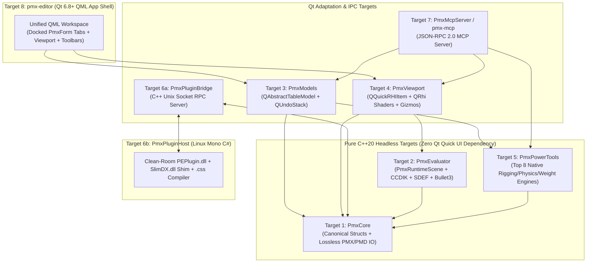

# Product Requirements & Technical Blueprint: Native Linux PMX Editor

---

## 1. Executive Summary & Core Objective

### Problem Statement
**PMXEditor** (created by *KyokuhokuP / 極北P*, final release `v0.2.7.3` in July 2022) is the indispensable 3D model assembly, rigging, material/morph engineering, and physics-debugging tool for the **MikuMikuDance (MMD)** ecosystem (`.pmx` 2.0/2.1 and `.pmd` formats). However, it is closed-source, discontinued Windows-only freeware built on `.NET Framework 4.8 (WinForms)` and `SlimDX (DirectX 9/11)`.

On Linux, 3D creators face two broken workflows:
1. **Running `PmxEditor.exe` via Wine/Bottles:** Requires fragile `dotnet48`, `d3dx9`, `d3dcompiler_47`, and `ja_JP` CJK font workarounds. Because PMXEditor splits its UI across multiple floating WinForms windows (`PmxForm`, `PmxView`, `TransformView`) backed by DirectX 9/11 swapchains, running it under XWayland/Wayland causes constant window-focus loss, dropped mouse clicks, frozen viewports on resize, and Shift-JIS path mojibake.
2. **Using Blender + `mmd_tools` as a Substitute:** While Blender excels at sculpting meshes from scratch, it **cannot replace PMXEditor** for finishing, kitbashing, or debugging MMD models because:
   * **Destructive Import/Export Round-Trip:** Importing a `.pmx` into Blender converts all data into Blender's internal mesh, armature, shape-key, and shader-node structures and re-synthesizes a `.pmx` on export. This frequently alters vertex index ordering, breaks custom split normals (ruining anime face/cel shading), loses or approximates **SDEF (`C`, `R0`, `R1`)** spherical skinning parameters, and mangles 28-channel multiplicative/additive **Material Morphs**.
   * **Lack of Spreadsheet Batch Engineering:** Kitbashing MMD models requires spreadsheet-style multi-row editing of raw PMX tables (Materials, Bones, Morphs, Display Frames `表示枠`, Rigid Bodies `剛体`, and 6DoF Spring Joints `Joint`).
   * **Lack of MMD-Exact `TransformView` (`T` Window):** MMD relies on a specific **Deform Tier (`変形階層`) + After-Physics (`物理後`)** bone evaluation order, a custom **CCDIK** solver, **Append/Grant bone inheritance (`付与`)**, **SDEF skinning**, and specific **Bullet Physics** constraint behaviors. Models that animate cleanly in Blender routinely explode or twist inside-out in MMD without live verification in `TransformView`.
   * **Reliance on the `PEPlugin` Ecosystem:** Tasks that take hours manually in Blender—such as rigging a pleated skirt with a grid of bones, smooth weights, collision capsules, and cross-linked spring joints (`曲面自動設定`), or inserting Arm/Wrist Twist helper bones with automatic cylindrical weight splitting (`準標準ボーン追加`)—are 1-click operations via PMXEditor plugins.

### Target Audience
* Linux-based MMD modelers, riggers, kitbashers ("frankensteiners"), and physics artists.
* Creators converting VRoid, VRM, Unreal/Unity, or Blender characters into motion-ready `.pmx` models compatible with standard `.vmd` dance motions.
* AI-assisted 3D creators who want an AI co-pilot (via **Model Context Protocol / MCP**) to automate tedious bone/morph naming, Display Frame organization, material morph creation, and physics debugging alongside their live 3D viewport.

### Primary Value Proposition
A **native Linux, Wayland-first C++20 / Qt 6.8+ (QML) PMX Editor** that provides:
1. **100% Lossless Binary PMX 2.0/2.1 Editing:** Direct 1:1 structural representation of the `.pmx` format—modifying one bone or material leaves every other byte, custom normal, vertex index, and SDEF parameter untouched.
2. **Unified Single-Window Workspace:** Combines the `PmxForm` spreadsheet tabs and `PmxView` / `TransformView` 3D viewport into a cohesive dark-themed QML layout with optional panel pop-outs for dual monitors.
3. **MMD-Accurate 3D Viewport & Live `TransformView`:** Built on `QQuickRHIItem` (`QRhi` Vulkan/OpenGL) with MMD Toon, Sphere Map, and Inverted-Hull Edge shaders, plus real-time CCDIK, Append bones, SDEF skinning, `.vmd`/`.vpd` playback, and `Bullet3` physics.
4. **Dual Plugin Ecosystem:** Ships with **Built-In Native C++ Implementations of the "Top 8" Community Plugins** out of the box, *plus* a Mono-based **`PmxPluginHost` (`PEPlugin.dll` + `SlimDX.dll` math shim + `.css` compiler)** so unmodified third-party BowlRoll plugins run natively on Linux.
5. **Built-In `PmxMcpServer` (Live AI Co-Pilot & Headless CLI):** Allows external MCP agents (Antigravity, Claude, local LLMs) to inspect, batch-edit, rig, and visually verify the open model in real time with full `Ctrl+Z` (`QUndoStack`) safety.

---

## 2. User Stories & Acceptance Criteria

### US-1: Lossless PMX 2.0 / 2.1 Binary Round-Trip & Surgical Editing
* **Given** a valid production `.pmx` 2.0 or 2.1 model file (containing BDEF1/2/4, SDEF, QDEF weights, custom normals, additional UV1–UV4 channels, all 6 morph types, Display Frames, Rigid Bodies, Joints, and SoftBodies),
* **When** the user loads the file into `PmxDocument` and immediately saves it to a new file without edits,
* **Then** the output binary file MUST be **100% byte-for-byte identical** to the input file.
* **And Given** the user edits a single material's Toon texture index and presses `Ctrl+Z` (Undo) followed by `Ctrl+Y` (Redo),
* **When** the file is saved,
* **Then** *only* the modified material's Toon fields change in the serialized binary while all vertices, normals, SDEF parameters, bones, and morphs remain byte-for-byte untouched.

### US-2: Kitbashing (`Import / Merge PMX`) & Multi-Format Import
* **Given** a base body `.pmx` model is open in the editor,
* **When** the user selects `File -> Import / Merge (`追加選択`)` and selects an outfit `.pmx`, legacy `.pmd`, or accessory `.obj`/`.fbx`/`.gltf` file,
* **Then** the imported geometry, materials, textures, bones, morphs, display frames, rigid bodies, and joints are appended to the active `PmxDocument` as a single undoable `QUndoCommand`, with automatic index offsetting and an option to merge identically named bones (e.g., `上半身`, `左腕`).

### US-3: High-Performance Spreadsheet Inspector & Batch Editing (`PmxForm`)
* **Given** a model with 100,000+ vertices, 50+ materials, 250+ bones, and 100+ rigid bodies/joints is loaded,
* **When** the user switches across the 8 inspector tabs (`Info`, `Vertex`, `Material`, `Bone`, `Morph`, `DisplayFrame`, `RigidBody`, `Joint`), toggles between Japanese (`JP`) and English (`EN`) labels, filters rows by name, or multi-selects 50 Rigid Body rows to batch-update their Collision Group Mask or Damping values,
* **Then** the QML `TableView` / `ListView` scrolls at a locked 60 FPS via virtualized `QAbstractTableModel` bindings, applies the batch edit atomically onto `QUndoStack`, and updates the 3D viewport overlays immediately.

### US-4: 3D Viewport Rendering, Selection & Weight Painting (`PmxView` Edit Mode)
* **Given** a model is open in **Edit Mode**,
* **When** the user orbits/pans/zooms the camera, toggles rendering layers (MMD Toon shading, `.sph`/`.spa` Sphere Maps, Inverted-Hull Edge outlines, Wireframe, Bone hierarchy, Rigid Body shapes, Joint axes), box-selects vertices/bones, transforms them with the 3D Translate/Rotate/Scale gizmo, or paints BDEF/SDEF weights with heatmap visualization,
* **Then** the `QQuickRHIItem` viewport renders accurately matching MMD's visual output, syncs 3D selections bidirectionally with the spreadsheet tabs, and commits completed gizmo/weight-paint strokes as `QUndoCommand` entries.

### US-5: Live `TransformView` Simulation (CCDIK, Append Bones, SDEF, VMD & Bullet3 Physics)
* **Given** the user toggles the viewport from **Edit Mode** to **TransformView Mode**,
* **When** the user rotates/translates bones, drags IK targets, adjusts Morph sliders, or loads a `.vmd` dance motion / `.vpd` pose with the `Bullet3` physics toggle enabled,
* **Then** `PmxRuntimeScene` evaluates Deform Tiers (`変形階層`), CCDIK chains, Append/Grant inheritance (`付与`), SDEF/BDEF skinning, and 60 Hz `btDiscreteDynamicsWorld` rigid-body/spring-joint physics in real time **without mutating the rest-pose `PmxDocument`** (unless the user explicitly clicks *"Apply Current Pose to Rest Mesh"*).

### US-6: Built-In Native MMD Power Tools (The "Top 8" Community Workflows)
* **Given** a user is rigging or finishing a model and invokes any of the 8 built-in C++ Power Tools from the `Tools` menu:
  1. **Curved Surface Auto-Rigging (`曲面自動設定` — Yaminabe-style)** on selected skirt/cape/hair vertices,
  2. **Semi-Standard Bone Generator (`準標準ボーン追加` — Soboro-style)** for Arm/Wrist Twist (`腕捩`/`手捩`), Mother Bone (`全ての親`), Groove (`グルーブ`), Waist Cancel, Thumb0, Toe EX, and D-Bones,
  3. **Weight Transfer (`ウェイト転送` — Oyatsu-style)** from a base body material to layered clothing (preserving BDEF1/2/4 & SDEF),
  4. **SDEF Auto-Converter (`ボーンウェイトSDEF化`)** on selected elbow/knee/shoulder vertices,
  5. **Bone-Chain Hair/Tail Physics Wizard (`選択ボーンから剛体・Joint作成`)**,
  6. **Anime Face Normal Editor (`法線編集` — Spherical/Ellipsoidal projection)**,
  7. **Multi-Stage Bone Splitter (`多段ボーン化`) & Batch Material Morph Creator (`材質モーフ一括作成`)**,
  8. **PMX Model Diagnostics & Crash Validator (`PMXデータの状態検証`)**,
* **When** the tool executes,
* **Then** the operation completes in native C++, pushes a single atomic `QUndoCommand` (revertible via `Ctrl+Z`), and immediately reflects all generated bones, weights, normals, morphs, rigid bodies, and joints in both the spreadsheet and 3D viewport.

### US-7: External Unmodified `PEPlugin.dll` & `.css` Plugin Compatibility
* **Given** a user places an unmodified Windows PMXEditor plugin (`.dll` compiled against `PEPlugin.dll` / `SlimDX.dll` or a plain-text `.css` C# script) into the `plugins/` directory,
* **When** the user clicks the plugin in the `Plugins` menu (including plugins that open modal or modeless `System.Windows.Forms` dialogs),
* **Then** `PmxPluginHost` (running natively under Linux Mono) loads the plugin against our clean-room `PEPlugin.dll` and CPU-math `SlimDX.dll` shim, communicates live over a local Unix domain socket with `PmxDocument` and viewport selection state, and wraps every `Connector.Pmx.Update(pmx)` call into a `QUndoCommand`.

### US-8: Live AI Co-Pilot & Headless Automation via `PmxMcpServer`
* **Given** an MCP-capable AI agent (such as Antigravity or Claude) connects to `pmx-mcp` while a model is open in the GUI (or in headless mode),
* **When** the agent calls high-level MCP tools (e.g., `standardize_vroid_names`, `create_material_morph`, `generate_curved_surface_physics`, `validate_and_fix_pmx`, `step_physics_and_capture_viewport`),
* **Then** the changes execute live on the GUI's `QUndoStack` (allowing instant `Ctrl+Z` by the user) and return structured JSON diagnostics or PNG viewport screenshots to the agent.

---

## 3. Core Data Entities & Architecture

### 3.1 Multi-Agent Subsystem Architecture & Module Boundaries
To allow multiple coding agents to work in parallel without merge conflicts, the repository is partitioned into **8 strictly decoupled CMake targets**:

| Target ID | CMake Target Name | Type | Responsibility & Agent Boundary |
| :--- | :--- | :--- | :--- |
| **Target 1** | `PmxCore` | C++20 Static Lib | Canonical PMX 2.0/2.1 structs, lossless binary Reader/Writer, `.pmd`/Assimp importers, kitbash Merger. Depends only on standard C++20, `glm`, and `QtCore` (`QString` UTF-8/UTF-16 codec). |
| **Target 2** | `PmxEvaluator` | C++20 Static Lib | `PmxRuntimeScene` (60 Hz TransformView state), Deform Tier scheduler, CCDIK solver, Append/Grant bone evaluator, CPU/GPU SDEF/BDEF/QDEF skinning, `.vmd`/`.vpd` parser, and `Bullet3` physics world (`btDiscreteDynamicsWorld`). |
| **Target 3** | `PmxModels` | C++20 Static Lib | `QUndoStack` command classes (`PmxUndoCommands.h`) and the 8 virtualized `QAbstractTableModel` / `QAbstractListModel` classes + `PmxSelectionManager` exposed to QML. |
| **Target 4** | `PmxViewport` | C++20 Static Lib | `QQuickRHIItem` subclass, `QRhi` pipeline (`qsb`-compiled GLSL 450 shaders for MMD Toon, Sphere, Edge, Wireframe, Bone/RigidBody/Joint overlays, Weight heatmap), Raycast/Box picking, and 3D Translate/Rotate/Scale Gizmos. |
| **Target 5** | `PmxPowerTools` | C++20 Static Lib | Pure C++20 implementations of the "Top 8" community tools operating on `PmxDocument` and returning atomic `PmxDocumentDelta` / `QUndoCommand` objects. |
| **Target 6** | `PmxPluginBridge` & `PmxPluginHost` | C++ Lib + Mono `.exe`/`.dll` | C++ local Unix domain socket server (`PmxPluginBridge`) + C# Mono assemblies (`PEPlugin.dll`, `SlimDX.dll` math shim, `PmxPluginHost.exe`) for loading external `.dll` and `.css` plugins. |
| **Target 7** | `PmxMcpServer` (`pmx-mcp`) | C++ Lib + CLI Binary | JSON-RPC 2.0 Model Context Protocol server supporting both Live GUI Co-Pilot mode (via local socket to `pmx-editor`) and Headless mode (linking `PmxCore` + `PmxPowerTools`). |
| **Target 8** | `pmx-editor` | Qt 6.8+ GUI Executable | Declarative QML UI (`Main.qml`, dockable `PmxForm` tabs, `PmxView` container, TransformView drawer, Power Tools dialogs, JP/EN switch). |

---

### 3.2 Canonical Data Entities (`PmxCore/PmxTypes.h`)
All agents MUST use the exact canonical structs defined in `namespace pmx`:

1. **`PmxHeader` & `PmxModelInfo`:**
   * `float version` (`2.0f` or `2.1f`)
   * `uint8_t textEncoding` (`0` = UTF-16LE, `1` = UTF-8)
   * `uint8_t additionalVec4Count` (`0`–`4` extra UV channels)
   * Index byte sizes (`1`, `2`, or `4` bytes) for `vertexIndexSize`, `textureIndexSize`, `materialIndexSize`, `boneIndexSize`, `morphIndexSize`, `rigidBodyIndexSize` (auto-recalculated on save, or preserved for lossless round-trip tests).
   * `std::u16string` / `QString` `modelNameJp`, `modelNameEn`, `commentJp`, `commentEn`.
2. **`PmxVertex`:**
   * `glm::vec3 position`, `glm::vec3 normal`, `glm::vec2 uv`
   * `std::array<glm::vec4, 4> additionalUVs`
   * `enum class WeightType : uint8_t { BDEF1 = 0, BDEF2 = 1, BDEF4 = 2, SDEF = 3, QDEF = 4 }`
   * `std::array<int32_t, 4> boneIndices`, `std::array<float, 4> boneWeights`
   * `glm::vec3 sdefC`, `glm::vec3 sdefR0`, `glm::vec3 sdefR1`
   * `float edgeScale`
3. **`PmxFace` & `PmxTexture`:**
   * `std::array<int32_t, 3> vertexIndices`
   * `QString relativePath` (with helper resolver for Windows `\` separators and Linux case-insensitive filename fallback).
4. **`PmxMaterial`:**
   * `QString nameJp`, `QString nameEn`
   * `glm::vec4 diffuse`, `glm::vec3 specular`, `float specularPower`, `glm::vec3 ambient`
   * `uint8_t drawFlags` (`NoCull = 0x01`, `GroundShadow = 0x02`, `DrawShadow = 0x04`, `ReceiveShadow = 0x08`, `HasEdge = 0x10`, `VertexColor = 0x20`, `PointDraw = 0x40`, `LineDraw = 0x80`)
   * `glm::vec4 edgeColor`, `float edgeSize`
   * `int32_t textureIndex`, `int32_t sphereTextureIndex`, `enum SphereMode : uint8_t { None=0, Mul=1, Add=2, SubTex=3 }`
   * `uint8_t sharedToonFlag` (`0` = custom texture index, `1` = shared `toon01.bmp`..`toon10.bmp` `0..9`), `int32_t toonIndex`
   * `QString memo`, `int32_t faceVertexCount` (always multiple of 3).
5. **`PmxBone` & `PmxIkLink`:**
   * `QString nameJp`, `QString nameEn`, `glm::vec3 position`, `int32_t parentBoneIndex`, `int32_t deformTier` (`変形階層`)
   * `uint16_t boneFlags` (`TailIsBone=0x0001`, `Rotatable=0x0002`, `Translatable=0x0004`, `Visible=0x0008`, `Enabled=0x0010`, `IK=0x0020`, `InheritLocal=0x0080`, `InheritRotation=0x0100`, `InheritTranslation=0x0200`, `FixedAxis=0x0400`, `LocalAxis=0x0800`, `PhysicsAfterDeform=0x1000`, `ExternalParent=0x2000`)
   * `glm::vec3 tailOffset` / `int32_t tailBoneIndex`
   * `int32_t inheritParentIndex`, `float inheritWeight`
   * `glm::vec3 fixedAxisVector`, `glm::vec3 localAxisX`, `glm::vec3 localAxisZ`
   * `int32_t externalKey`
   * `int32_t ikTargetBoneIndex`, `int32_t ikLoopCount`, `float ikLimitAngle` (radians), `std::vector<PmxIkLink> ikLinks` (`boneIndex`, `hasLimit`, `limitMin`, `limitMax`).
6. **`PmxMorph`:**
   * `QString nameJp`, `QString nameEn`, `uint8_t panelCategory` (`0=Hidden, 1=Eyebrow, 2=Eye, 3=Mouth, 4=Other`), `MorphType` (`Group=0, Vertex=1, Bone=2, UV=3, AdditionalUV1..4=4..7, Material=8, Flip=9, Impulse=10`)
   * Typed offset vectors (`VertexMorphOffset`, `UvMorphOffset`, `BoneMorphOffset`, `MaterialMorphOffset` with `opType` `0=Mul, 1=Add` and all 28 float fields, `GroupMorphOffset`, `ImpulseMorphOffset`).
7. **`PmxDisplayFrame` (`表示枠`):**
   * `QString nameJp`, `QString nameEn`, `uint8_t specialFrameFlag` (`0=Normal, 1=Root/Exp`), `std::vector<DisplayElement>` (`isMorph`, `elementIndex`).
8. **`PmxRigidBody` (`剛体`):**
   * `QString nameJp`, `QString nameEn`, `int32_t boneIndex`, `uint8_t groupIndex` (`0..15`), `uint16_t nonCollisionMask`
   * `enum Shape : uint8_t { Sphere=0, Box=1, Capsule=2 }`, `glm::vec3 size`, `glm::vec3 position`, `glm::vec3 rotation` (Euler radians)
   * `float mass`, `float linearDamping`, `float angularDamping`, `float restitution`, `float friction`
   * `enum PhysicsMode : uint8_t { FollowBone=0, Physics=1, PhysicsAndBone=2 }`.
9. **`PmxJoint` (`Joint`) & `PmxSoftBody` (PMX 2.1):**
   * `JointType` (`Spring6DoF=0`, plus PMX 2.1 `SixDoF=1, P2P=2, ConeTwist=3, Slider=4, Hinge=5`), `int32_t rigidBodyIndexA`, `int32_t rigidBodyIndexB`, `glm::vec3 position`, `glm::vec3 rotation`, `glm::vec3 linearLowerLimit`, `glm::vec3 linearUpperLimit`, `glm::vec3 angularLowerLimit`, `glm::vec3 angularUpperLimit`, `glm::vec3 springLinearStiffness`, `glm::vec3 springAngularStiffness`.
   * Complete `PmxSoftBody` struct for lossless PMX 2.1 read/write round-tripping.

---

### 3.3 State Separation & Concurrency Contract
1. **`PmxDocument` (Rest-Pose Ground Truth):**
   * Lives on the main thread inside `PmxDocumentController`.
   * **Rule:** No UI widget, 3D gizmo, plugin, or MCP tool may mutate `PmxDocument` directly. All mutations MUST go through `QUndoStack::push(new PmxUndoCommand(...))`.
2. **`PmxRuntimeScene` (TransformView Evaluated State):**
   * Owned by `PmxEvaluator`. Reads a const reference to `PmxDocument` and maintains separate arrays for `evaluatedPositions`, `evaluatedNormals`, `boneWorldMatrices`, `morphWeights`, and `Bullet3` rigid body transforms.
   * Ticks at 60 Hz during TransformView mode without touching `PmxDocument`.

---

## 4. Recommended Tech Stack & Rationale

| Layer | Choice | Rationale |
| :--- | :--- | :--- |
| **Core Language** | **C++20** (`gcc` / `clang`) | Zero-overhead binary parsing, `std::span`, `constexpr`, and direct compatibility with `glm` and `Bullet3`. |
| **Build System** | **CMake 3.24+ & Ninja** | Fast incremental builds and clean multi-target separation for parallel agent development. |
| **UI Framework** | **Qt 6.8+ (`QtQuick`, `QtQuickControls2`)** | Native Wayland/X11 windowing, hardware-accelerated virtualized `TableView` for 100k+ vertex spreadsheets, and declarative dark-theme UI. |
| **3D Rendering** | **`QQuickRHIItem` (`QRhi` + `qsb` GLSL 450)** | Qt 6.8's modern rendering abstraction over Vulkan and OpenGL; avoids legacy `QQuickFramebufferObject` Wayland glitches while embedding seamlessly inside QML layouts. |
| **3D Math & Physics** | **`glm` + `Bullet3` (`libbullet-dev`)** | Standard Linux system packages (`libglm-dev`, `libbullet-dev`). `Bullet3` provides `btDiscreteDynamicsWorld` and `btGeneric6DofSpringConstraint` required for exact MMD physics. |
| **MMD Evaluation Reference** | **`Saba` & `babylon-mmd` (MIT Port)** | Rather than wrapping `Saba` as a read-only black box, we port its battle-tested MIT-licensed CCDIK, Append-bone, and SDEF math directly into `PmxEvaluator` operating on our canonical `PmxCore` structs. |
| **Mesh/Texture Import** | **`Assimp` (`libassimp-dev`) & `stb_image` / `QImage`** | Enables importing `.obj`/`.fbx`/`.gltf` accessories and loading `.bmp`/`.png`/`.tga`/`.dds`/`.sph`/`.spa` textures. |
| **External Plugin Host** | **Linux Mono (`mono-devel`, `System.Windows.Forms`)** | Compiles and runs unmodified `.NET Framework 4.x` `PEPlugin` `.dll`s and `.css` C# scripts natively on Linux (including WinForms dialogs) without Wine or DirectX. |
| **AI Co-Pilot Protocol** | **Model Context Protocol (MCP over JSON-RPC 2.0)** | Allows external coding/3D agents to inspect and manipulate the open model via `QUndoStack`-backed semantic tools. |
| **Testing Framework** | **QtTest (`ctest`)** | Automated byte-level round-trip serialization tests, validator tests, and headless power-tool tests. |

---

## 5. Out of Scope (Anti-Goals for v1)

To keep the v1.0 blast radius tight and prevent scope creep, agents MUST NOT build the following in v1:
1. **General-Purpose 3D Mesh Sculpting / Retopology / UV Unwrapping Suite:** We are building a **PMX Editor**, not recreating Blender's sculpting brushes, BMesh boolean modeling, or complex UV island unwrapping.
2. **Full Timeline Keyframe Animation Editor & Video Renderer:** TransformView plays back `.vmd` motions and `.vpd` poses to test rigging and physics, but authoring multi-character dance videos, camera keyframes, or MME (MikuMikuEffect `.fx`) HLSL post-processing belongs to MMD/MMM/Blender, not PMXEditor.
3. **Legacy DirectX 9 GPU-Pointer Plugins (`IPEViewPlugin` / `SlimDX.Direct3D9.Device`):** Our `PmxPluginHost` supports `IPEPlugin` data/UI plugins (`~99%` of all community plugins) and `SlimDX` CPU vector/matrix math. We explicitly exclude the `<1%` of plugins that attempt to hook raw DirectX 9 GPU device pointers.
4. **Legacy `.pmd` Binary Writer:** `.pmd` is supported for **Import/Read** (upgrading automatically into a `PmxDocument`), while all saves output `.pmx` 2.0 or 2.1.
5. **PMX 2.1 SoftBody Simulation in TransformView:** `PmxCore` MUST read and write `PmxSoftBody` records losslessly for byte-identical PMX 2.1 round-tripping, but live SoftBody physics simulation in TransformView is out of scope for v1 (standard RigidBody + 6DoF Spring Joint physics covers 99.9% of MMD models).

---

## 6. Milestone 1 (The "Tracer Bullet")

Before scaling out to all 8 tabs, shaders, and power tools, **Milestone 1** delivers a thin, end-to-end vertical slice across all architectural layers that compiles and passes automated tests from day one:

### Scope of the Tracer Bullet
1. **Repository & Build Skeleton (`CMakeLists.txt`):**
   * Configures C++20, Qt 6.8+ (`Core`, `Gui`, `Quick`, `QuickControls2`, `ShaderTools`, `Test`), `glm`, and `Bullet3`, defining the modular targets (`PmxCore`, `PmxModels`, `PmxViewport`, `PmxMcpServer`, `pmx-editor`, and `tests/`).
2. **Lossless `PmxCore` Binary Reader & Writer + Round-Trip Unit Test:**
   * Implements all canonical structs in `PmxTypes.h` and full binary deserialization/serialization in `PmxReader.cpp` and `PmxWriter.cpp`.
   * **Verification Gate:** `ctest` runs `tst_pmx_roundtrip`, which constructs/loads a `.pmx` 2.0/2.1 model (with BDEF/SDEF vertices, materials, bones with IK/Append flags, all morph types, display frames, rigid bodies, and joints), writes it to a memory buffer, and asserts **100% byte-for-byte identity**.
3. **Undoable `PmxDocumentController` + `Bone` & `Material` Table Models (`PmxModels`):**
   * Implements `PmxDocumentController` owning `PmxDocument` and `QUndoStack`, exposing `PmxBoneTableModel` and `PmxMaterialTableModel` (`QAbstractTableModel`) with `Ctrl+Z` / `Ctrl+Y` undoable cell editing and JP/EN name toggling.
4. **Unified Qt 6.8+ QML Window + `QQuickRHIItem` 3D Viewport (`PmxViewport` & `pmx-editor`):**
   * Launches a single dark-themed QML window with a top toolbar (`Open PMX`, `Save PMX`, `Undo`, `Redo`, `JP/EN Toggle`), a left/center `QQuickRHIItem` 3D viewport rendering the loaded PMX mesh + bone wireframe overlay with orbit/pan/zoom camera controls, and a right-docked inspector showing the `Info`, `Material`, and `Bone` spreadsheet tabs.
5. **Live `PmxMcpServer` Tracer Tool (`get_model_summary` & `rename_bone`):**
   * Exposes a local socket / `stdio` MCP endpoint where calling `rename_bone` updates the bone name inside the running GUI via `QUndoStack`, immediately updates the QML Bone table, and reverts cleanly when the user presses `Ctrl+Z`.
